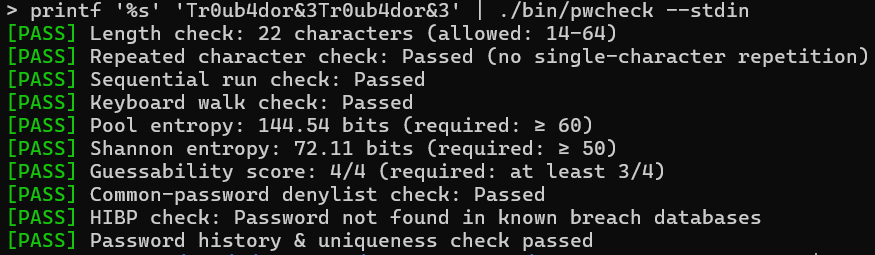

# Password Policy Checker

**Better passwords start with better checks.**

A modular Bash CLI that evaluates password length, predictable patterns, estimated entropy, guessability, breach exposure, and reuse against a configurable policy.


[Getting started](#getting-started) · [Usage](#usage) · [Policy reference](#policy-reference) · [How it works](#how-it-works) · [Implementation notes](#implementation-notes)

## Preview



## At a glance

| Layer | What it checks |
| --- | --- |
| Length | Configurable minimum and maximum password length |
| Patterns | Single-character repetition, six-character alphabetic or numeric sequences, and six-key QWERTY row walks, including reversed sequences |
| Entropy | Character-pool and character-frequency Shannon estimates |
| Guessability | A `zxcvbn` score from 0 to 4, with pattern-category feedback |
| Denylist | Common passwords after lowercasing and common leetspeak substitutions |
| Breach exposure | Have I Been Pwned's Pwned Passwords range API |
| History | Exact reuse, small numeric suffix changes, and similarity by Levenshtein distance |

## Getting started

### Requirements

- Bash 4 or newer, including support for associative arrays.
- Python 3 with the [`zxcvbn`](https://pypi.org/project/zxcvbn/) package.
- Standard Unix tools: `awk`, `grep`, `tr`, `tail`, `sha256sum`, `mktemp`, `mkdir`, `mv`, and `chmod`.
- For breach checks: `curl`, an internet connection, and either `sha1sum` or `shasum`.

The current launcher expects **`python.exe`**. Git Bash on Windows is a practical starting environment; a native Linux or macOS Python installation alone does not satisfy that launcher check. WSL use also requires access to a Windows Python environment.

### Setup

Run these commands in Git Bash:

```bash
git clone https://github.com/MohsenDowlati/password-policy-checker.git
cd password-policy-checker

python.exe -m venv .venv
source .venv/Scripts/activate
python.exe -m pip install zxcvbn
```

> **Development status:** The current `bin/pwcheck` contains a malformed `fiit 2` statement in its input-handling block. The usage examples below document the intended interface; the entry point needs correction before normal password checks can run.

Run from the repository root: relative denylist and history paths resolve against your current working directory.

## Usage

### Interactive check

```bash
bash bin/pwcheck
```

The interactive prompt reads from `/dev/tty` with terminal echo disabled.

### Read from standard input

```bash
printf '%s\n' 'example-only-password' | bash bin/pwcheck --stdin
```

Only the first input line is read. This example uses a disposable value; entering a real password directly in a shell command can leave it in shell history.

### Choose a policy

```bash
bash bin/pwcheck --config config/policy.conf
```

### Validate configuration

```bash
bash bin/pwcheck --check-config
bash bin/pwcheck --config config/policy.conf --check-config
```

Configuration validation prints the resolved settings without evaluating a password.

### Options

| Option | Purpose |
| --- | --- |
| `-c, --config PATH` | Load a policy file; defaults to the repository's `config/policy.conf` |
| `-s, --stdin` | Read a password from standard input |
| `--check-config` | Validate configuration and exit |
| `-h, --help` | Display help |

### Output and exit codes

Check diagnostics go to standard error with `[PASS]`, `[FAIL]`, `[WARN]`, or `[ERROR]` prefixes. Color is enabled when standard error is a terminal; set `NO_COLOR=1` to disable it.

| Code | Intended meaning |
| --- | --- |
| `0` | Password passes all active checks, or an informational command succeeds |
| `1` | Password fails policy requirements |
| `2` | Usage, input, configuration, or dependency error |

## Policy reference

The shipped [`config/policy.conf`](config/policy.conf) uses these values:

| Setting | Shipped value | Purpose |
| --- | --- | --- |
| `MIN_LENGTH` | `14` | Minimum password length |
| `MAX_LENGTH` | `64` | Maximum password length |
| `MIN_POOL_ENTROPY` | `60` | Minimum character-pool entropy estimate, in bits |
| `MIN_SHANNON_ENTROPY` | `50` | Minimum total Shannon entropy estimate, in bits |
| `MIN_ZXCVBN_SCORE` | `3` | Minimum guessability score on the 0–4 scale |
| `DENYLIST_PATH` | `./data/common-passwords.txt` | Common-password list, one entry per line |
| `HIBP_CHECK_ENABLED` | `1` | Enable (`1`) or disable (`0`) breach lookup |
| `HIBP_TIMEOUT` | `3` | Breach lookup timeout, in seconds |
| `HISTORY_MAX_COUNT` | `5` | Number of recent entries retained and compared |
| `HISTORY_FILE_PATH` | `./data/history/password_history.log` | Local password history file |
| `NEAR_DUPLICATE_MAX_DISTANCE` | `3` | Reject history matches at or below this edit distance |

Policy files use literal `KEY=VALUE` assignments, with no spaces around `=`. Blank lines and whole-line `#` comments are accepted. Unknown keys and duplicate definitions are rejected. Values are parsed as data, so paths should be written without shell quotes or variable expansion.

To use local checks without a network request, set:

```ini
HIBP_CHECK_ENABLED=0
```

The pattern checks remain active independently of the configurable thresholds.

## How it works

```text
Load policy → Read password → Length & patterns → Entropy → zxcvbn
                                                          ↓
                Exit status ← History ← HIBP ← Common-password denylist
```

### Length & Composition

The shipped policy accepts passwords between **14 and 64 characters**. Adjust `MIN_LENGTH` and `MAX_LENGTH` to set the allowed range.

Composition checks reject passwords made entirely of one repeated character, six consecutive letters or digits such as `abcdef` or `654321`, and six adjacent keys in a QWERTY row such as `qwerty`. Sequence and keyboard checks are case-insensitive and include reversed runs. There is no separate requirement to include uppercase letters, digits, or symbols.

### Entropy & Strength Estimation

- **Entropy:** Pool entropy estimates `length × log₂(pool size)`. Shannon entropy uses the observed character frequencies, multiplied by length. Both are heuristics; the guessability check adds a separate view of predictable structure.
- **Guessability:** The Python helper returns the `zxcvbn` score, an estimated guess-count logarithm, and selected pattern categories. It also supplies the project-specific context words `mohsen`, `dowlati`, and `cyberphoenix` to the scorer.

The shipped thresholds require at least **60 bits of pool entropy**, **50 bits of total Shannon entropy**, and a **zxcvbn score of 3/4**. Configure these with `MIN_POOL_ENTROPY`, `MIN_SHANNON_ENTROPY`, and `MIN_ZXCVBN_SCORE`.

### Denylist Checks

The input is lowercased and normalized with common leetspeak substitutions such as `@ → a`, `3 → e`, and `0 → o`, then compared against whole lines in `DENYLIST_PATH`. Matching is case-insensitive and uses literal text, so denylist entries are not treated as regular expressions.

Extend `data/common-passwords.txt` with one blocked value per line, or point `DENYLIST_PATH` to another readable file. Since normalization applies to the submitted password, write entries in their normalized form.

### Breach Exposure

The password is SHA-1 hashed locally. Only the first five hexadecimal hash characters are sent to the [Pwned Passwords range API](https://haveibeenpwned.com/API/v3#SearchingPwnedPasswordsByRange); returned suffixes are compared locally. No API key is required.

Control this check with `HIBP_CHECK_ENABLED` and `HIBP_TIMEOUT`. Failed requests produce a warning and skip the lookup.

### Reuse & History

The history check compares the candidate against the most recent `HISTORY_MAX_COUNT` entries in `HISTORY_FILE_PATH` and rejects:

- **Exact reuse:** The candidate's SHA-256 hash matches a stored hash.
- **Incremental variants:** Both passwords share the same text after removing digits, have trailing numbers, and those numbers differ by no more than five.
- **Near duplicates:** The Levenshtein edit distance is at or below `NEAR_DUPLICATE_MAX_DISTANCE`, which defaults to **3**.

The shipped policy retains **5 recent entries**. History stores the original passwords alongside their hashes, and entries can be appended even when another policy check fails; see [Implementation notes](#implementation-notes) before using sensitive inputs.

## Project layout

```text
password-policy-checker/
├── bin/
│   └── pwcheck                 CLI entry point
├── config/
│   └── policy.conf             Shipped policy
├── data/
│   ├── history/password_history.log
│   └── common-passwords.txt    Local denylist
└── lib/
    ├── composition.sh          Repetition, sequences, and keyboard walks
    ├── config.sh               Configuration parsing and validation
    ├── denylist.sh             Normalization and denylist matching
    ├── entropy.sh              Pool and Shannon entropy estimates
    ├── guessability.sh         Python scoring integration
    ├── hibp.sh                 Breach lookup
    ├── history.sh              Reuse and similarity checks
    ├── utils.sh                Logging and path helpers
    └── zxcvbn_score.py         Guessability scoring helper
```

## Implementation notes

These behaviors matter when interpreting a result or handling sensitive input:

- **History contains plaintext.** Entries store both a SHA-256 hash and the original password. The implementation attempts to restrict file permissions with `chmod 600`, but does not encrypt the file. An incremental-change failure can also print both the previous and submitted passwords. Use disposable inputs while evaluating the project.
- **History can change after a failed evaluation.** A password is appended when its history check passes, even if an earlier policy check failed.
- **Breach lookup is best effort.** A failed or timed-out API request produces a warning and skips the check. A successful overall exit therefore does not always mean breach exposure was verified.
- **Runtime handling is still in development.** Beyond the entry-point syntax issue, counter post-increments under `set -e` can terminate execution early, and some configuration range guards need correction. The documented exit codes describe the intended interface.

---

# This Shit Cooked By MOHSEN.
